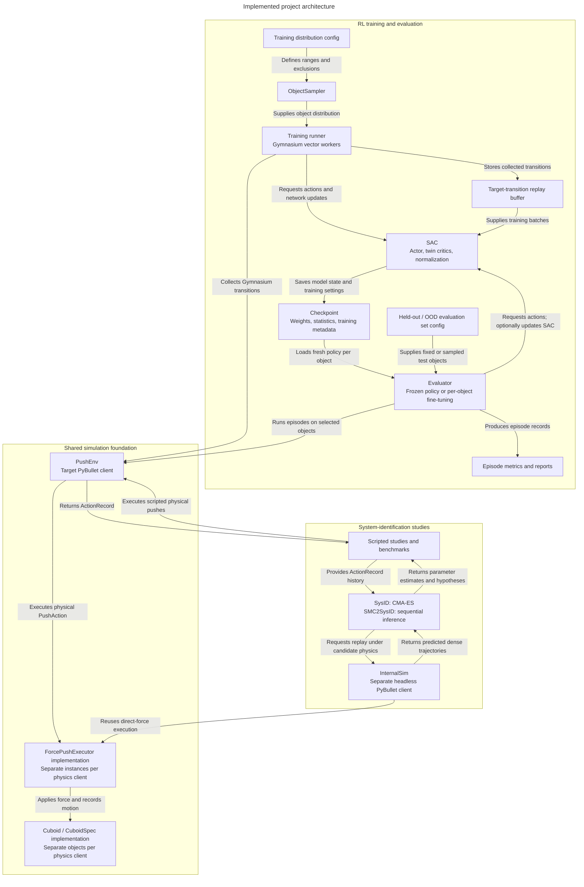
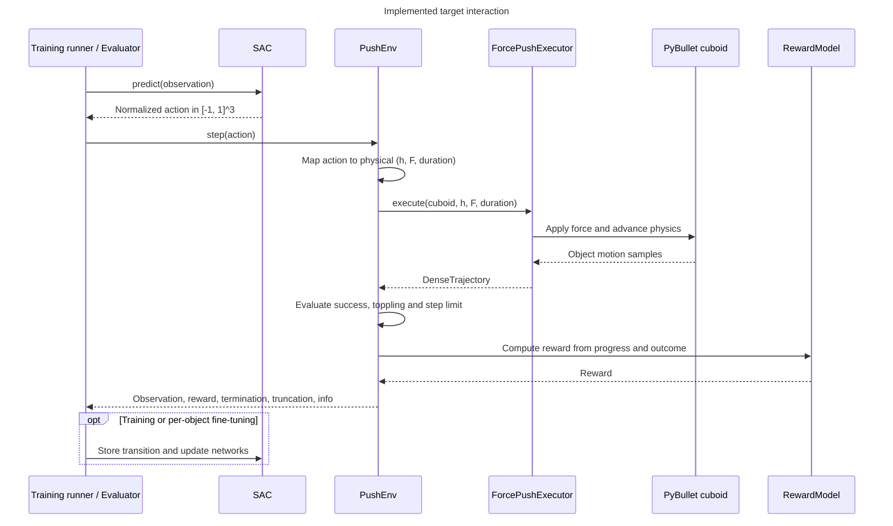

# Overall project architecture

Simulation-Assisted Toppling-Safe Pushing studies whether object-specific physics imagination can improve adaptation while reducing toppling. Geometry is observable; mass, object-floor friction, and vertical COM height are hidden. Both the target system and internal model use PyBullet in this sim-to-sim study.

Reviewed against the working tree on 2026-10-31 after the readability cleanup. The [project outline](../project_outline.md) defines the intended research method; it does not establish that every integration is implemented.

The implemented system has two workflows sharing a simulation foundation: SAC training/evaluation and simulator-based system-identification studies. The complete online adaptation loop remains planned.

## Implemented components

Editable source: [mermaid/overall-components.mmd](mermaid/overall-components.mmd).

Every node and solid arrow represents implemented functionality. This is a component view: target environments and internal simulations own separate physics clients, cuboids, and executors. Multiple training workers also own separate environments.

Training distribution configuration defines ranges and exclusions; `ObjectSampler` performs sampling. Evaluation set selection and membership classification belong to the experiment layer. `PushEnv` owns interaction, observations, reward, and episode semantics.

The training runner collects target transitions, updates observation statistics and SAC, and periodically runs frozen validation in a separate environment. Checkpoints contain model state, observation statistics, and training metadata; adjacent `config.json` records training settings.

Held-out evaluation loads a fresh checkpoint for each object and condition. Frozen evaluation uses deterministic actions and an inference-only model without replay. Fine-tuning uses stochastic actions and new target replay for that object; observation normalization stays frozen. Fine-tuning results measure performance during learning, without an additional final-policy evaluation.

System-identification studies separately collect action histories and fit candidate physics using CMA-ES or SMC². Their simulator replay is not connected to SAC training or held-out evaluation.
The study runners call module functions for data loading, metrics, plots, grid
integration, and predictive evaluation. `ReplayCountingSimulator` adds only a
replay counter to `InternalSim`. See the [SysID workflow guide](../../src/evaluation/system_identification/README.md)
for helper entry points and saved-result changes.

## One target interaction

Editable source: [mermaid/target-interaction.mmd](mermaid/target-interaction.mmd).

Solid arrows are calls or data delivery; dashed arrows are returns. The sequence shows a policy-driven interaction after training warm-up; initial training collection can instead sample random actions.

The policy receives seven observable values: `(d, psi, xdot, psidot, w, L, H)`. Its three normalized actions are clipped and mapped to physical height, force, and duration. Hidden mass, friction, and COM height are never appended to the policy observation. Ground truth is exposed through diagnostic `info` and recorded for evaluation.

`PushEnv.push()` records the pre-action state, physical action, and dense trajectory in an `ActionRecord`. `step()` calls `push()` but currently discards its returned record; it retains the trajectory and returns it through `info`. Online SysID integration will need to preserve the complete record.

Reward and episode bookkeeping happen after execution. Current terminal toppling uses the final tilt; peak tilt is reported separately through `info`. Success or toppling terminates an episode; exhausting the action budget otherwise truncates it. SAC replay disables bootstrapping for true termination.

The runner and evaluator store transitions through `model.replay` and call `model.update()`; the final sequence arrow summarizes those operations. Training updates follow the configured collection schedule, while fine-tuning updates after each push.

## Planned integrated adaptation

Editable source: [mermaid/planned-adaptation.mmd](mermaid/planned-adaptation.mmd).

```mermaid
---
title: Planned online adaptation using physics imagination
---
flowchart LR
    OBS["Observable target state"]
    POL["SAC actor and critics"]
    FIL["Pessimistic action filter"]
    ENV["Target PushEnv"]
    HIST["Object-specific ActionRecord history"]
    FIT["System identification"]
    HYP["Physics hypotheses<br/>Mass, friction, COM"]
    SIM["Internal simulator"]
    ROLL["Short imagined rollouts"]
    TARGET["Target replay"]
    SYN["Simulated replay"]
    UPDATE["SAC update<br/>Controlled mixture of both buffers"]
    OBS -->|"Policy observation"| POL
    POL -.->|"Candidate actions and critic values"| FIL
    FIL -.->|"Selected action"| ENV
    ENV -.->|"Observed next state"| OBS
    ENV -.->|"Executed action and dense trajectory"| HIST
    HIST -.->|"Accumulated interaction evidence"| FIT
    FIT -->|"Parameter estimates and hypotheses"| HYP
    HYP -.->|"Candidate physics"| SIM
    OBS -.->|"Rollout starting state"| ROLL
    POL -.->|"Rollout actions"| ROLL
    ROLL -.->|"Requests simulated pushes"| SIM
    SIM -.->|"Predicted motion"| ROLL
    FIL -.->|"Checks candidates across hypotheses"| SIM
    SIM -.->|"Predicted peak tilt and toppling"| FIL
    ROLL -.->|"Imagined transitions"| SYN
    ENV -.->|"Target transitions"| TARGET
    TARGET -.->|"Target samples"| UPDATE
    SYN -.->|"Simulated samples"| UPDATE
    UPDATE -.->|"Updated networks"| POL
    classDef planned fill:#fff4d6,stroke:#a66b00,stroke-dasharray:5 5
    class FIL,HIST,ROLL,SYN,UPDATE planned
```

Solid arrows show existing component capabilities. Dashed arrows show integration required for this online loop, including connections already available separately in the model-free workflow. Amber nodes identify new coordination logic or behavior; the existing SAC updater would need mixed replay support.

The intended loop estimates physics from object-specific history, generates short hypothetical rollouts, and updates SAC from target and simulated replay with a controlled sampling ratio. Estimated parameters configure the simulator rather than becoming policy inputs.

The optional pessimistic filter checks candidates across the hypothesis set. The specification rejects candidates with predicted toppling or excessive peak tilt, chooses the highest critic value among survivors, and falls back to the smallest worst-case predicted tilt when none survives. This proposed rule is not a validated safety guarantee.

`InternalSim.replay()` currently returns a dense trajectory for one recorded action under candidate physics. A Dyna rollout generator additionally needs consistent observation construction, action mapping, reward, termination, and multi-action state progression. The complete SysID-to-imagination-to-SAC-to-filter loop is not wired into runtime code.

## Source map

| Responsibility | Source |
|---|---|
| SAC networks, normalization, replay, and checkpoints | [`sac.py`](../../src/agents/rl/sac.py) |
| Vector collection, training, and validation | [`train_sac.py`](../../src/agents/rl/training/train_sac.py) |
| Shared frozen evaluation and per-object fine-tuning | [`evaluator.py`](../../src/evaluation/rl/evaluator.py) |
| Held-out evaluation and reports | [`evaluate.py`](../../src/evaluation/rl/evaluate.py) |
| Evaluation cases and checkpoint-relative membership | [`evaluation_sets.py`](../../src/evaluation/rl/evaluation_sets.py) |
| Training-distribution sampling | [`sampling.py`](../../src/simulation/modelling/sampling.py) |
| Target interaction and episode semantics | [`env.py`](../../src/simulation/environment/env.py), [`reward.py`](../../src/simulation/environment/reward.py) |
| Shared physical model, actions, and records | [`object.py`](../../src/simulation/modelling/object.py), [`actions.py`](../../src/simulation/modelling/actions.py), [`records.py`](../../src/simulation/modelling/records.py) |
| Direct-force execution and dense trajectories | [`force_push.py`](../../src/simulation/execution/force_push.py) |
| Candidate-physics replay | [`internal_sim.py`](../../src/agents/simulator/internal_sim.py) |
| CMA-ES and SMC² estimation | [`sysid.py`](../../src/agents/system_identification/sysid.py), [`smc2.py`](../../src/agents/system_identification/smc2.py) |
| SysID studies and diagnostics | [`system_identification/`](../../src/evaluation/system_identification/) |
| Physics validation and interactive demos | [`simulation/tools/`](../../src/simulation/tools/) |
| Intended imagination, shielding, and experiments | [`project_outline.md`](../project_outline.md), sections 7–8 and baseline table |

## Implementation boundaries

- `RobotPushExecutor` is currently a stub whose constructor and `execute()` raise `NotImplementedError`. Robot execution is a planned substitution beneath `PushExecutor`; the implemented target path uses direct force. See [`robot.py`](../../src/simulation/execution/robot.py).
- The target and internal simulator share model and execution code, but do not share physics state. Robot/contact mismatch will require separate validation when robot execution is implemented.
- CMA-ES hypothesis weights derive from trajectory losses; SMC² weights arise from sequential likelihood inference. A shared result container does not make their uncertainty interpretations equivalent.
- These diagrams summarize the main runtime boundaries. They are not an exhaustive class inventory or evidence of learning performance, identification accuracy, or safety.

## Diagram maintenance and validation

The Markdown embeds the three standalone `.mmd` sources for convenient viewing. Keep each embedded block identical to its corresponding source when editing.

Relationships were checked against the source files listed above after the
cleanup. Relative links and equality of embedded and standalone diagram sources
are checked separately from runtime behavior. The cleanup passed 215 tests;
its benchmark outputs and five SAC updates matched the saved pre-cleanup
versions. These checks do not establish training performance. Mermaid rendering
has not been independently validated.
