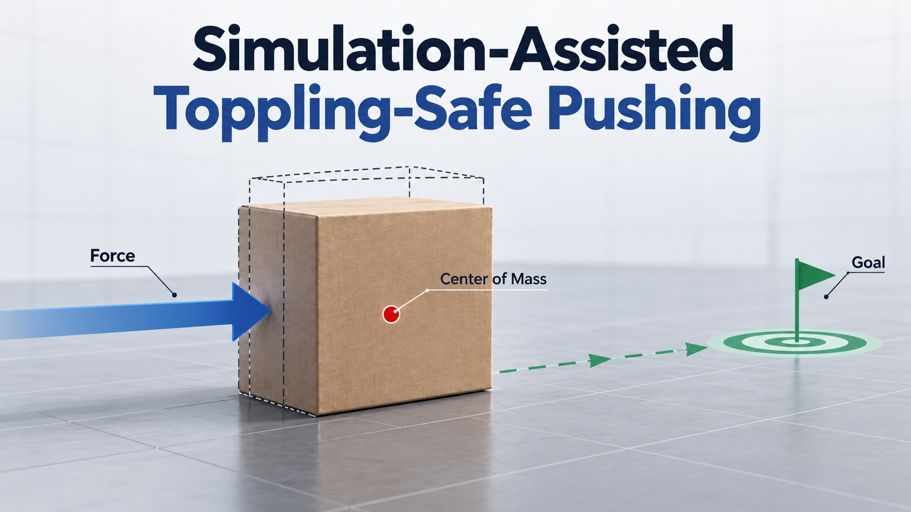
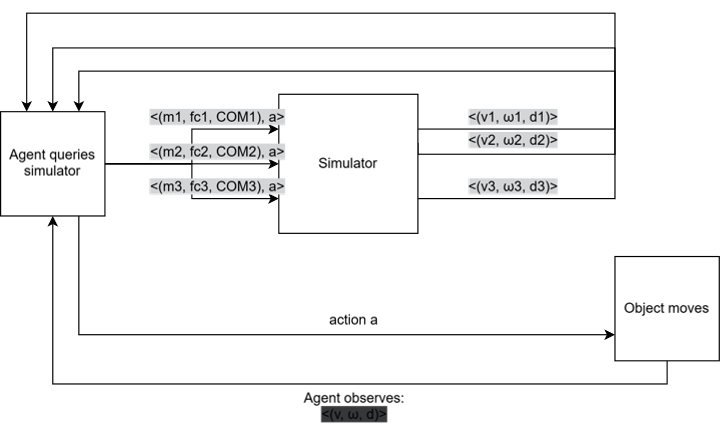

# Project Proposal: Simulation-Assisted Toppling-Safe Pushing

## 1. Research Question and Hypothesis

This project studies whether a physics simulator can serve as an agent's **imagination** when adapting to objects with unknown dynamics. An upright cuboid must be pushed toward a target without toppling. The object geometry is observable, but its mass, object-floor friction, and vertical center-of-mass (COM) height are hidden.

**Research question**

> Can simulation-generated hypothetical trajectories improve a Soft Actor-Critic (SAC) agent's ability to push unfamiliar objects safely and efficiently when mass, friction, and vertical COM are unknown or out of distribution?

**Primary hypothesis**

> An agent that estimates plausible object dynamics and augments SAC with short simulator-generated rollouts will experience fewer topples and require fewer target-environment interactions than model-free SAC. Maintaining multiple plausible physics hypotheses and filtering actions pessimistically is expected to be more robust than relying on a single point-estimate simulator, especially under moderate simulator mismatch.

All experiments are **sim-to-sim**. The target PyBullet environment acts as the unknown physical system, while a separate internal PyBullet instance acts as the agent's approximate simulator.

---

## 2. Problem Formulation

### 2.1 Hidden and observed variables

The object has observable geometry

$$
G = (w, L, H),
$$

where $w$ is width along the push direction, $L$ is depth, and $H$ is height.

Its hidden physical parameters are

$$
\theta = (m, \mu, h_c),
$$

where $m$ is mass, $\mu$ is the object-floor friction coefficient, and $h_c$ is vertical COM height. The true values are available only to the experimental environment for evaluation; they are never given directly to the policy.

The full environment state can be written as

$$
s_t = (d_t, \psi_t, \dot{x}_t, \dot{\psi}_t, G, m, \mu, h_c),
$$

while the policy observes only

$$
o_t = (d_t, \psi_t, \dot{x}_t, \dot{\psi}_t, G).
$$

Here, $d_t$ is distance to the target, $\psi_t$ is tilt angle, $\dot{x}_t$ is translational velocity along the push axis, and $\dot{\psi}_t$ is angular velocity about the tipping axis. The object does **not** need to settle between decisions, so velocity is part of the observation.

### 2.2 Action

Each decision is one externally applied horizontal force primitive:

$$
a_t = (h_t, F_t, \tau_t),
$$

where:

- $h_t$ is the force-application height on the rear face;
- $F_t$ is the force magnitude directed toward the target;
- $\tau_t$ is the duration for which the force is applied.

The commanded push direction is fixed, and contact is restricted to the rear face's vertical centreline to focus on forward motion and tipping. Early stages use direct force application in PyBullet. The final stages must incorporate a simulated robot arm whose low-level controller executes the same $(h,F,\tau)$ commands through approach, contact, timed pushing, and retraction. The internal imagination simulator remains a direct-force model. Commanded and realized execution data, contact failures, and total execution time will be recorded; robot reachability and scripted pushes will be validated before policy evaluation.

### 2.3 Reward

The reward encourages fast progress while making toppling costly:

$$
r_t =
\alpha(d_{t-1}-d_t)
- c_{\mathrm{time}}\tau_t
- c_{\mathrm{step}}
+ R_{\mathrm{succ}}\,\mathbb{I}_{\mathrm{succ},t}
- R_{\mathrm{topple}}\,\mathbb{I}_{\mathrm{topple},t}.
$$

The first term rewards progress toward the target. The time and step costs encourage efficient completion. A successful placement receives $+R_{\mathrm{succ}}$, while toppling receives $-R_{\mathrm{topple}}$ and terminates the episode. No explicit penalty is placed on object velocity or force magnitude: aggressive motion is acceptable if it reaches the target quickly without toppling or overshooting.

---

## 3. Method

### 3.1 Online system identification and internal simulation

After each target action, the dense object trajectory is recorded. The same action is replayed in the internal simulator under candidate values of $(m,\mu,h_c)$. Candidate parameters are scored by how closely simulated position, tilt, translational velocity, and angular velocity match the target trajectory.

A derivative-free optimizer such as CMA-ES produces a point estimate and, where computationally feasible, a small set of low-loss hypotheses

$$
\Theta_K = \{\theta_1, \theta_2, \ldots, \theta_K\}.
$$

These estimates are used **only to configure the internal simulator**; they are not appended to the SAC observation. This isolates the value of simulator-generated experience from the value of directly giving estimated physics to the policy.

### 3.2 SAC model

The base learner is Soft Actor-Critic because the action space is continuous. The actor

$$
\pi_\phi(a\mid o)
$$

outputs a stochastic distribution over normalized values of an action $(h,F,\tau)$. Two critics

$$
Q_{\theta_1}(o,a), \qquad Q_{\theta_2}(o,a)
$$

estimate action value, with the standard SAC entropy objective encouraging exploration.

Target transitions are stored in $\mathcal{D}_{\mathrm{target}}$. After system identification, the internal simulator is reset to the current observed state and generates short hypothetical rollouts under the fitted physics hypotheses. These transitions are stored in $\mathcal{D}_{\mathrm{sim}}$. SAC is updated from a controlled mixture of the two replay buffers.

A second, uncertainty-aware variant uses the same hypothesis set as a **pessimistic safety filter**: candidate actions are simulated under every plausible $\theta_k$, and an action is rejected if **any** hypothesis predicts excessive tilt or toppling.

The main comparison is therefore:

1. **Model-free SAC** — target replay only;
2. **Point-estimate imagination** — SAC plus rollouts from the best-fit simulator;
3. **Ensemble imagination** — rollouts sampled from several plausible simulators;
4. **Ensemble imagination + pessimistic filter** — proposed full method;
5. **Oracle simulation** — true $(m,\mu,h_c)$ supplied to the internal simulator as an upper-bound control.

Evaluation will include in-distribution objects and OOD shifts in mass, friction, COM height, and their combinations. Primary metrics are cumulative topples during adaptation, success rate, target interactions to first success, elapsed time to success, and parameter-estimation error.

---

## 4. Literature Review

The project combines ideas from model-based RL, online system identification, adaptive simulation, safe RL, and non-prehensile pushing. Sutton's **Dyna** framework established the idea of mixing real experience with model-generated experience for learning and planning [1]. **MBPO** later showed that short model-generated rollouts can improve sample efficiency while limiting model-bias accumulation [2]. This motivates using short hypothetical trajectories rather than long open-loop simulated episodes.

For simulator adaptation, **SimOpt** adjusts simulation parameter distributions using a small amount of target-world experience [3], while **BayesSim** explicitly models uncertainty over simulator parameters [4]. **UP-OSI** estimates unknown dynamics online and conditions a universal policy on those estimates [5], and **RMA** demonstrates rapid adaptation to changing dynamics from recent interaction history [6]. In contrast, this project deliberately does not feed estimated $(m,\mu,h_c)$ directly to the policy; the estimates affect behavior through the simulator and generated experience.

Safety shielding is also established in RL: Alshiekh et al. introduced a shield that blocks actions predicted to violate safety constraints [7]. Here, the shield is not a formal logic model but an ensemble of physics simulations. Finally, recent work on constrained RL for dynamic object pushing shows that learned policies can adapt to unknown object properties and avoid toppling [8]. The proposed contribution is therefore not toppling-aware pushing or simulated experience individually, but a controlled study of **uncertainty-aware, object-specific physics imagination** and when it helps or hurts safe adaptation.

---

## 5. Six-Week Timeline

| Week | Goal | Deliverable |
|---|---|---|
| **1** | Build and validate the environment | Cuboid generator, external-force action primitive, observation/reward logic, success/topple detection, scripted physics sanity tests |
| **2** | Implement system identification | CMA-ES estimation of $m$, $\mu$, and $h_c$; identifiability experiments using varied force height, magnitude, and duration |
| **3** | Train the base SAC agent | SAC pretraining with randomized dynamics; model-free adaptation baseline and initial OOD test set |
| **4** | Add simulation-generated experience | Point-estimate Dyna-style rollouts, nominal-simulator baseline, oracle-simulator control |
| **5** | Add uncertainty-aware imagination | Top-$K$ physics hypotheses, ensemble rollouts, pessimistic action filter, main ID/OOD experiments; integrate and validate simulated robot centreline pushes |
| **6** | Final experiments and analysis | Parameter-error sensitivity, mild simulator-mismatch study, confidence intervals, final robot-executed policy demonstration/evaluation, plots, report and presentation |

**Scope control:** simulated robot execution is a required final-stage deliverable. Arbitrary lateral contact positions on the rear face, learned joint-level control, cross-engine experiments, point-cloud perception, non-cuboid shapes, active information-seeking, and physical robot validation are excluded from the six-week core project.

---

## References

1. R. S. Sutton, "Integrated Architectures for Learning, Planning, and Reacting Based on Approximating Dynamic Programming," *ICML*, 1990. https://doi.org/10.1016/B978-1-55860-141-3.50030-4
2. M. Janner, J. Fu, M. Zhang, and S. Levine, "When to Trust Your Model: Model-Based Policy Optimization," *NeurIPS*, 2019. https://proceedings.neurips.cc/paper/2019/hash/5faf461eff3099671ad63c6f3f094f7f-Abstract.html
3. Y. Chebotar et al., "Closing the Sim-to-Real Loop: Adapting Simulation Randomization with Real World Experience," *ICRA*, 2019. https://doi.org/10.1109/ICRA.2019.8793789
4. F. Ramos, R. C. Possas, and D. Fox, "BayesSim: Adaptive Domain Randomization via Probabilistic Inference for Robotics Simulators," *RSS*, 2019. https://doi.org/10.15607/RSS.2019.XV.029
5. W. Yu, J. Tan, C. K. Liu, and G. Turk, "Preparing for the Unknown: Learning a Universal Policy with Online System Identification," *RSS*, 2017. https://doi.org/10.15607/RSS.2017.XIII.048
6. A. Kumar, Z. Fu, D. Pathak, and J. Malik, "RMA: Rapid Motor Adaptation for Legged Robots," *RSS*, 2021. https://doi.org/10.15607/RSS.2021.XVII.011
7. M. Alshiekh et al., "Safe Reinforcement Learning via Shielding," *AAAI*, 2018. https://doi.org/10.1609/aaai.v32i1.11797
8. I. Dadiotis, M. Mittal, N. G. Tsagarakis, and M. Hutter, "Dynamic Object Goal Pushing with Mobile Manipulators Through Model-Free Constrained Reinforcement Learning," *ICRA*, 2025. https://doi.org/10.1109/ICRA55743.2025.11128166
